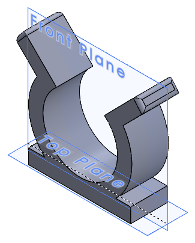
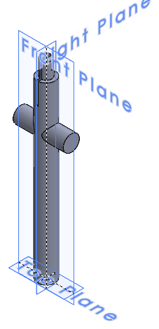
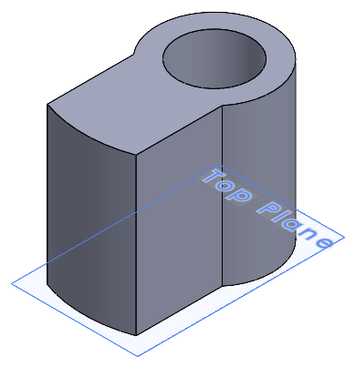
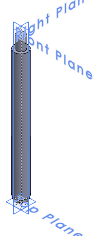
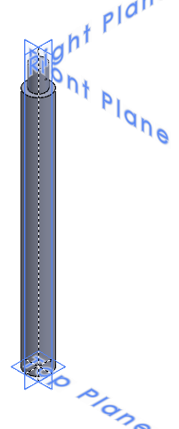
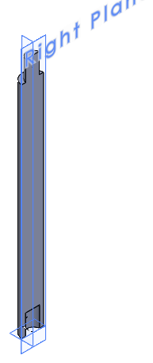
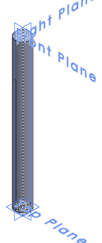

# CAD Design

SolidWorks part files for the 3D-printed cane and the pod mount. The images are the previews SolidWorks stores inside each `.SLDPRT`.

  
  &nbsp;&nbsp;
  
  &nbsp;&nbsp;
  
   <em>Pod clip, cane segment 4 and motor mass.</em>

## Overview

The 130 cm cane is a Ø22 mm rod split into six 216.7 mm segments, so each part fits a standard printer bed. Segments join with spigot-and-socket fittings locked by cross-pins. The pod attaches with `HackathonClipping`, 0.72 m from the tip (segment 4), as set in the [DATA REPORT](../docs/SafeRoute_DATA_REPORT.pdf).

## Parts

| Preview | Part file | Description | Print qty |
| :---: | --- | --- | :---: |
|  | [`HackathonStaff1.SLDPRT`](HackathonStaff1.SLDPRT) | Segment 1: tip, rounded end | 1 |
|  | [`HackathonStaff2+3.SLDPRT`](HackathonStaff2+3.SLDPRT) | Segments 2 and 3 (same part) | 2 |
|  | [`HackathonStaff4.SLDPRT`](HackathonStaff4.SLDPRT) | Segment 4: carries a Ø20 × 62 mm crossbar; the pod sits on this segment | 1 |
|  | [`HackathonStaff5.SLDPRT`](HackathonStaff5.SLDPRT) | Segment 5: D-shaped half; two halves form the rod | 2 |
|  | [`HackathonStaff6.SLDPRT`](HackathonStaff6.SLDPRT) | Segment 6: top / handle end | 1 |
|  | [`HackathonClipping.SLDPRT`](HackathonClipping.SLDPRT) | Clip that mounts the pod on the cane | 1 |
|  | [`UnbalancedMass.SLDPRT`](UnbalancedMass.SLDPRT) | Off-centre mass for the vibration motor | 2 |

## Assembly Order

From the tip upward (each segment 216.7 mm):

| Position | Part | Distance from tip |
| :---: | --- | --- |
| 1 | `HackathonStaff1` (tip) | 0 – 0.22 m |
| 2 | `HackathonStaff2+3` | 0.22 – 0.43 m |
| 3 | `HackathonStaff2+3` | 0.43 – 0.65 m |
| 4 | `HackathonStaff4` (pod mounted here, 0.72 m) | 0.65 – 0.87 m |
| 5 | `HackathonStaff5` × 2 (halves) | 0.87 – 1.08 m |
| 6 | `HackathonStaff6` (handle end) | 1.08 – 1.30 m |

A 5 mm through-slot runs along segments 4–6 (about 0.82–1.25 m from the tip), giving a channel for wires from the pod toward the handle.

## Print Notes

| Item | Value |
| --- | --- |
| Joint fit | Spigot Ø13.6 × 19.8 mm into socket Ø14.0 × 20 mm (0.2 mm clearance per side) |
| Cross-pins | Ø1 mm holes through each joint |
| Longest part | 236.5 mm: needs a bed axis of at least 240 mm, or print on the diagonal |

Open the parts in SolidWorks, or export them as STL for slicing.
