<a id="readme-top"></a>

<div align="center">

# SafeRoute Smart Cane

**A clip-on pod that gives a standard white cane a one-step warning for drop-offs and head-level obstacles, delivered as haptic rhythm.**

[](firmware)
[](firmware/platformio.ini)
[](firmware/test/test_core)
[](experiment_data)
[](#acknowledgments)

[**Live Dashboard**](https://ktviy.github.io/SafeRoute_Smart_Cane/dashboard/) ·
[**Data Report (PDF)**](docs/SafeRoute_DATA_REPORT.pdf) ·
[**Schematic**](hardware/schematic.svg) ·
[**Firmware Guide**](firmware/README.md) ·
[**Experiment Results**](experiment_data/results/report.md)

</div>

<details>
<summary><b>Table of Contents</b></summary>

1. [About the Project](#about-the-project)
2. [Key Results](#key-results)
3. [How It Works](#how-it-works)
4. [Hardware](#hardware)
5. [Getting Started](#getting-started)
6. [Usage](#usage)
7. [Experiment Data](#experiment-data)
8. [Repository Structure](#repository-structure)
9. [Roadmap](#roadmap)
10. [Team](#team)
11. [Acknowledgments](#acknowledgments)
12. [License](#license)

</details>

---

## About the Project

A white cane is excellent at reading what is directly under its tip, but it misses two kinds of hazard that matter for low-vision travellers:

| Hazard | Examples | Why the cane misses it |
| --- | --- | --- |
| **Drop-offs** | Curbs, stair tops, platform edges | The tip finds the edge at nearly the same moment the user reaches it, leaving little time to react. |
| **Head-level obstacles** | Signs, branches, open truck doors | The cane sweeps the ground and passes underneath them. |

**SafeRoute** is a small pod that clips onto an existing cane. Two time-of-flight beams look ahead of the tip and up to head height. When a real hazard appears, two vibration motors send a distinct rhythm up the shaft to the hand. A three-rule filter keeps the pod **silent during normal sweeping**, so every buzz means something.

**Design principles**

- **Augment, don't replace.** The user keeps their cane and their training; the pod only adds information.
- **Alert only on hazards.** Constant feedback causes fatigue and gets ignored. The pod stays quiet unless a confirmed hazard is inside the walking corridor.
- **Every number from real data.** All thresholds and mounting angles come from 18 recordings of a real cane user. Nothing in this repository is simulated.

<p align="center">
  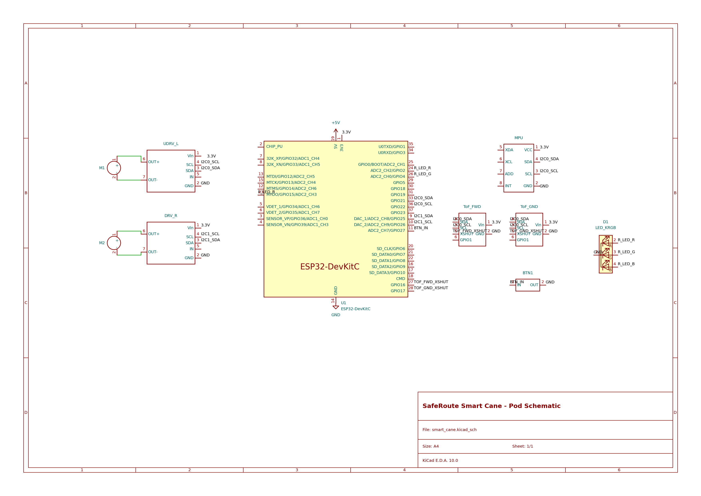
  <br><em>Schematic of the pod (KiCad).</em>
</p>

<p align="right">(<a href="#readme-top">back to top</a>)</p>

## Key Results

Measured on real cane recordings (walker P1, 30 Oct – 3 Nov 2026). Full method and data in the [DATA REPORT](docs/SafeRoute_DATA_REPORT.pdf).

| Metric | Result |
| --- | --- |
| Look-ahead past the cane tip | **~0.76 m** |
| Warning time at walking speed (0.78–0.84 m/s) | **0.79–0.86 s** |
| Frames a 30 cm drop stays in the beam (fastest sweep) | **3.9 frames** at 30 Hz, so 3-frame confirmation **passes** |
| Firmware angle error while walking (p95) | **2.4–3.4°** (≈ 1 cm drop-height error per degree; alert threshold is 8 cm) |
| Cane angle while walking | 41.1° (36.5–45.1°) on 120 cm cane → **36.9°** on the 130 cm build |
| Sweep frequency / half-width (p95) | 0.45–0.49 Hz / 23–24° |
| Cane angle after finding an edge | 63–84° peak, past 57° within 0.6–0.9 s |
| Stair descent rhythm | 1.47 s per step |

<p align="right">(<a href="#readme-top">back to top</a>)</p>

## How It Works

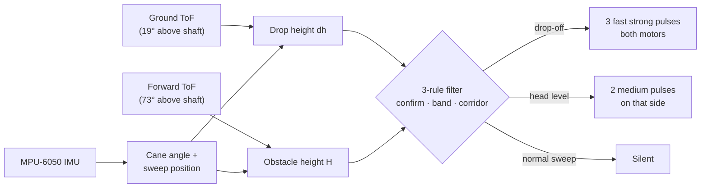

1. **Sensing.** The **ground beam** hits the floor about 0.76 m past the tip. Combined with the cane angle, it gives the floor height ahead (`dh`); a drop deeper than **8 cm** is a drop-off. The **forward beam** measures how high an obstacle in front is.
2. **Sweep tracking.** The MPU-6050 IMU gives the cane angle and the position within the sweep. The user holds a trained **38°** angle and sweeps **±23°**, both taken from the recordings.
3. **Filtering.** An alert must pass three rules:
   - **Confirmation:** seen in 3 consecutive frames (2 for head level).
   - **Height band:** the measured height falls in the hazard's band.
   - **Corridor:** the hazard is in the walking path, not beside it.

   When the cane is lifted above **52°** (the user has already found the edge), the pod goes quiet.
4. **Haptics.** Each hazard has its own rhythm, so the user can tell them apart without thinking.

The decision logic is plain, hardware-free C++ in [`firmware/lib/saferoute`](firmware/lib/saferoute), so it runs and is unit-tested on a laptop. The equations are in the [firmware guide](firmware/README.md#how-the-logic-works).

<p align="right">(<a href="#readme-top">back to top</a>)</p>

## Hardware

### Bill of Materials

| Part | Qty | Role |
| --- | :---: | --- |
| ESP32-DevKitC (ESP32-WROOM-32) | 1 | Controller: sensor loop, haptics, USB and BLE telemetry |
| VL53L1X time-of-flight sensor | 2 | Ground beam (drop-offs) and forward beam (head level) |
| MPU-6050 6-axis IMU (accelerometer + gyro) | 1 | Cane angle, sweep position, tip taps |
| DRV2605L haptic motor driver | 2 | Left / right haptic waveforms |
| Vibrating mini motor disc (Adafruit 1201, ERM) | 2 | Left / right vibration |
| RGB LED (common cathode) | 1 | Status |
| Push button | 1 | On / off |
| USB power bank | 1 | 5 V supply |
| 3D-printed pod and 130 cm cane | — | Pod mounted 0.72 m from the tip |

### Pin Map

| Signal | ESP32 pin |
| --- | --- |
| I2C0 SDA / SCL (ToF sensors, IMU, left haptic driver) | GPIO21 / GPIO22 |
| I2C1 SDA / SCL (right haptic driver) | GPIO25 / GPIO26 |
| ToF XSHUT (ground / forward) | GPIO17 / GPIO16 |
| Button | GPIO27 |
| RGB LED (R / G / B) | GPIO2 / GPIO4 / GPIO15 |

Full BOM with references, design notes and the KiCad project are in [`hardware/`](hardware).

### Mechanical Design

The cane and pod mount are modelled in SolidWorks; part files are in [`CAD_Design/`](CAD_Design). The 130 cm cane is a Ø22 mm rod printed in six 216.7 mm segments that join with spigot-and-socket fittings and cross-pins.

<p align="center">
  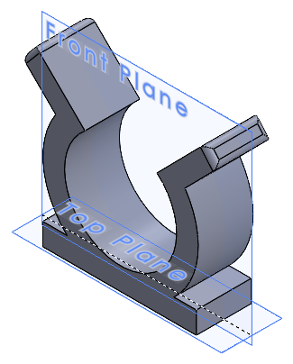
  &nbsp;&nbsp;
  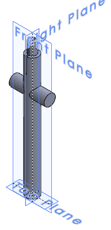
  &nbsp;&nbsp;
  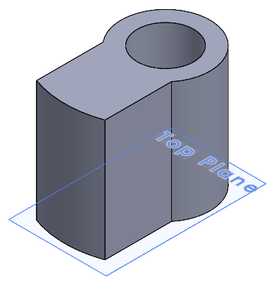
  <br><em>Pod clip, pod-mount cane segment and motor mass (SolidWorks previews).</em>
</p>

| Preview | Part file | Description |
| :---: | --- | --- |
| 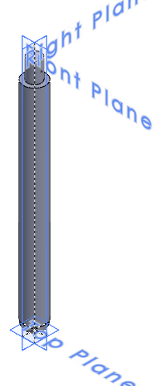 | [`HackathonStaff1.SLDPRT`](CAD_Design/HackathonStaff1.SLDPRT) | Segment 1: tip, rounded end |
| 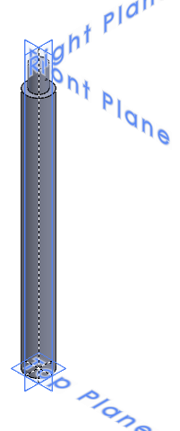 | [`HackathonStaff2+3.SLDPRT`](CAD_Design/HackathonStaff2+3.SLDPRT) | Segments 2 and 3 (print ×2) |
|  | [`HackathonStaff4.SLDPRT`](CAD_Design/HackathonStaff4.SLDPRT) | Segment 4: crossbar at ~0.81 m from the tip for the pod mount |
| 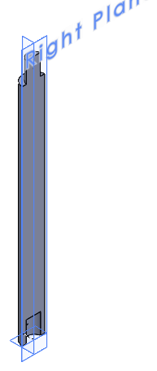 | [`HackathonStaff5.SLDPRT`](CAD_Design/HackathonStaff5.SLDPRT) | Segment 5: D-shaped half (print ×2) |
| 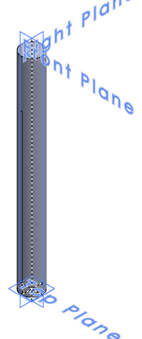 | [`HackathonStaff6.SLDPRT`](CAD_Design/HackathonStaff6.SLDPRT) | Segment 6: top / handle end |
|  | [`HackathonClipping.SLDPRT`](CAD_Design/HackathonClipping.SLDPRT) | Clip that mounts the pod on the cane |
|  | [`UnbalancedMass.SLDPRT`](CAD_Design/UnbalancedMass.SLDPRT) | Off-centre mass for the vibration motor |

A 5 mm through-slot runs along segments 4–6 (about 0.82–1.25 m from the tip), giving a channel for wires from the pod toward the handle.

<p align="right">(<a href="#readme-top">back to top</a>)</p>

## Getting Started

### Prerequisites

- [PlatformIO](https://platformio.org/) (VS Code extension or `pip install platformio`)
- `gcc` on your PATH for the native unit tests
- Python 3.9+ for the experiment analysis
- Chrome or Edge for the web dashboard (Web Serial / Web Bluetooth)

### Build and Flash the Firmware

```bash
git clone https://github.com/ktviy/SafeRoute_Smart_Cane.git
cd SafeRoute_Smart_Cane/firmware

pio test -e native              # run the 45 unit tests on your laptop
pio run -e esp32dev -t upload   # build and flash the pod
pio device monitor              # 460800 baud, type 'help'
```

> [!TIP]
> On Windows, run `pio` from PowerShell. If upload hangs at `Connecting...`, hold **BOOT**, tap **EN**, and release BOOT when writing starts. More fixes are in the [troubleshooting table](firmware/README.md#build-flash-test).

### Reproduce the Analysis

```bash
cd experiment_data
pip install numpy pandas matplotlib
python analyze_cane.py analyze  # rebuilds results/ and results/plots/
```

<p align="right">(<a href="#readme-top">back to top</a>)</p>

## Usage

### Controls

| Action | Result |
| --- | --- |
| Power on | Pod starts **OFF** (lasers held off, low current) |
| **Click** | Pod turns **ON**: lasers start, one left-then-right ring, LED on |
| **Double click** | Pod turns **OFF** |

### Haptic Language

| Pattern | Meaning |
| --- | --- |
| 3 fast strong pulses, both motors | Drop-off ahead |
| 4 rapid strong pulses | Drop-off ahead, little time left |
| 2 medium pulses on one side | Head-level obstacle on that side |
| Left-then-right ring | Pod ON / calibration OK |
| 1 soft 600 ms pulse | A sensor is down ("pod blind") |

The full pattern list is in the [firmware guide](firmware/README.md#using-the-pod).

### Live Dashboard

Open the [**live dashboard**](https://ktviy.github.io/SafeRoute_Smart_Cane/dashboard/) in Chrome or Edge, power the pod, then press **USB** or **Bluetooth**. It shows cane angle, drop height, alerts and mode in real time with no install. A Python version is in [`dashboard/dashboard.py`](dashboard/dashboard.py).

<p align="right">(<a href="#readme-top">back to top</a>)</p>

## Experiment Data

Walker P1 walked with a phone (Sensor Logger, 100 Hz) strapped to a 120 cm white cane, producing **18 recordings**: static angles, sweeping and walking with both techniques (constant contact and two-point touch), curb step-down and step-up, objects beside the path, stair tops, stair descents, and timed walks. Angles were then mapped to the 130 cm build cane ([`cane_130cm.py`](experiment_data/cane_130cm.py)).

| Walking, constant contact (S04) | Walking, two-point touch (S05) |
| :---: | :---: |
| 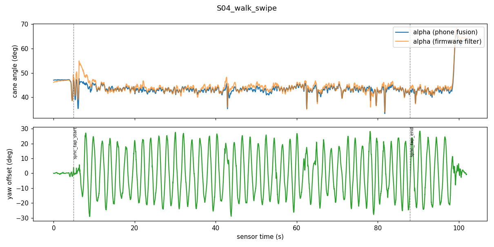 | 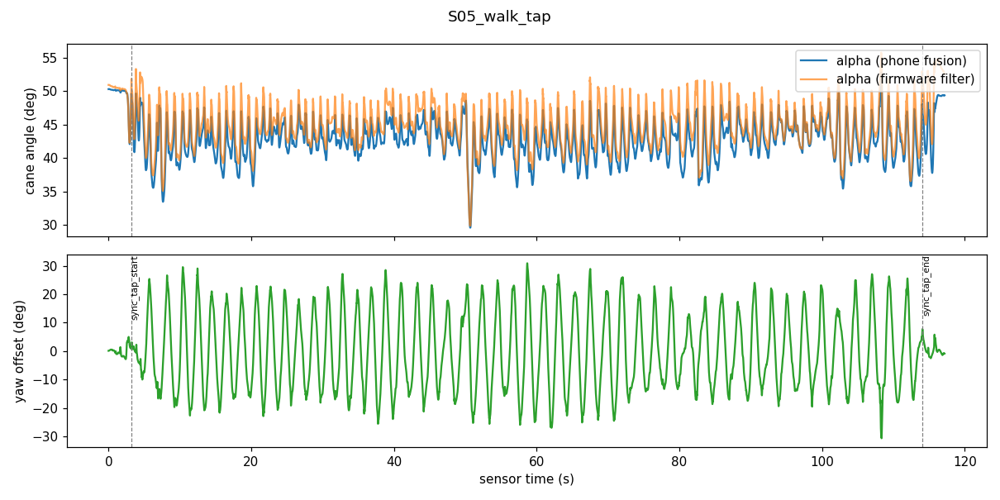 |
| **Stair top found (S11)** | **Curb step-down (S06)** |
| 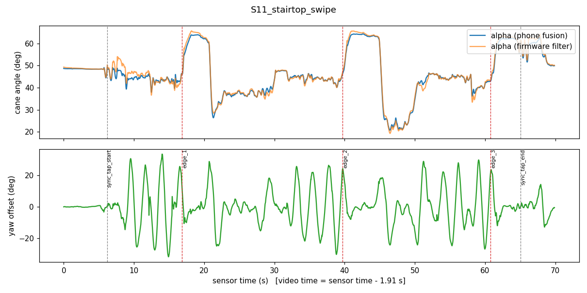 | 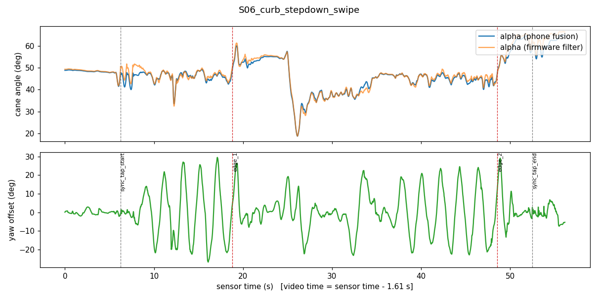 |

All 17 plots are in [`experiment_data/results/plots/`](experiment_data/results/plots) and the numbers are in the [results report](experiment_data/results/report.md). The videos used to time-align events (179 MB) are not included; [`video_sync.csv`](experiment_data/video_sync.csv) and [`events.csv`](experiment_data/events.csv) keep the timings they produced.

<p align="right">(<a href="#readme-top">back to top</a>)</p>

## Repository Structure

```
SafeRoute_Smart_Cane/
├── firmware/            ESP32 firmware (PlatformIO)
│   ├── include/config.h     every tunable number and pin
│   ├── lib/saferoute/       hardware-free pod logic (kinematics, filter, haptics, ...)
│   ├── src/                 ESP32 main loop, HAL drivers, BLE telemetry
│   └── test/                45 native unit tests
├── hardware/            KiCad schematic project + SVG/PNG export
├── CAD_Design/          SolidWorks parts (cane segments, pod clip, motor mass) + preview images
├── experiment_data/     raw cane recordings, analysis scripts, results and plots
├── dashboard/           web dashboard (Web Serial / Web Bluetooth) + Python version
└── docs/                DATA REPORT: every design number and its source
```

<p align="right">(<a href="#readme-top">back to top</a>)</p>

## Roadmap

- [x] Clip-on pod with dual ToF beams and dual haptic motors
- [x] IMU-based cane angle and sweep tracking
- [x] Three-rule alert filter with edge-found pause
- [x] Live web dashboard over USB and Bluetooth
- [x] Design numbers derived from 18 real cane recordings
- [ ] Verify the cane angle statically on the 130 cm build cane
- [ ] Test with more walkers and orientation & mobility instructors
- [ ] Custom PCB and smaller enclosure

<p align="right">(<a href="#readme-top">back to top</a>)</p>

## Team

| Member | Role |
| --- | --- |
| **Vy Khong** | Electrical engineering, firmware, data analysis, dashboard |
| **Andy** | Mechanical design and CAD, beam angles, haptic test rigs |

<p align="right">(<a href="#readme-top">back to top</a>)</p>

## Acknowledgments

- Built at **MakeCU 2026**, Columbia University (Healthcare Robot track).
- [SparkFun VL53L5CX Arduino Library](https://github.com/sparkfun/SparkFun_VL53L5CX_Arduino_Library) for the ToF driver.
- [Sensor Logger](https://www.tszheichoi.com/sensorlogger) for the phone IMU recordings.
- README structure inspired by [Best-README-Template](https://github.com/othneildrew/Best-README-Template) and [SmartKnob](https://github.com/scottbez1/smartknob).

<p align="right">(<a href="#readme-top">back to top</a>)</p>

## License

No license has been chosen yet. Until one is added, all rights are reserved by the authors.

<p align="right">(<a href="#readme-top">back to top</a>)</p>
