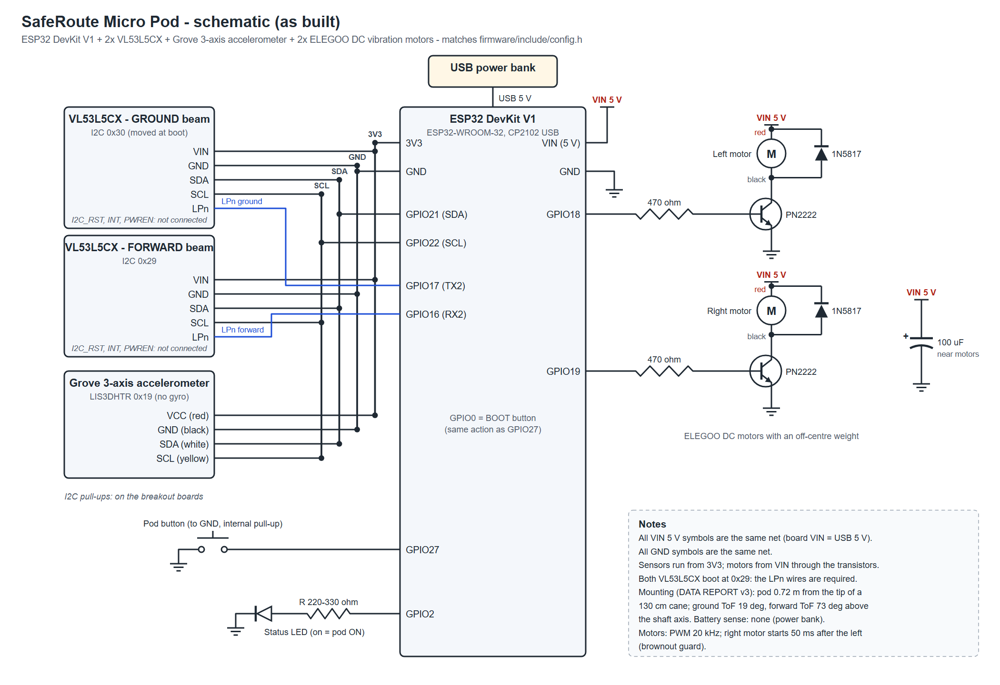

# Hardware

## As built

`schematic_as_built.svg` / `.png` show the circuit on the pod. The pin numbers match `firmware/include/config.h`.

The schematic has four parts:

- **Sensors.** Two VL53L5CX sensors and the Grove accelerometer share one I2C bus (GPIO21 SDA, GPIO22 SCL) and the 3V3 supply. Each VL53L5CX has its own LPn line (GPIO17 for ground, GPIO16 for forward). At boot the firmware moves the ground sensor to I2C address 0x30.
- **Motors.** Each motor is wired as: GPIO18/19 -> 470 ohm -> PN2222 base. The emitter goes to GND and the collector to the motor's black lead. The motor's red lead goes to VIN 5 V. A 1N5817 flyback diode sits across each motor, and a 100 uF capacitor across VIN-GND.
- **Button and LED.** The button goes from GPIO27 to GND (internal pull-up). The LED is driven from GPIO2 through a series resistor.
- **Power.** A USB power bank plugs into the DevKit's USB port.

## Original KiCad design (`kicad_original_plan/`)

This is the first schematic, drawn before the build. It uses the parts we planned at the time:
- 2x DRV2605L haptic drivers with ERM motors;
- an MPU-6050 IMU (with gyro);
- 2x VL53L1X single-zone ToF sensors;
- an RGB LED and a button on an ESP32-DevKitC.

The pod was built with the parts the event kit provided instead: VL53L5CX, a Grove accelerometer, and DC motors on PN2222 transistors. So **the KiCad file does not match the built pod.** It is kept as a record of the design. Use the as-built schematic above to wire the pod. Open `smart_cane.kicad_pro` in KiCad 8 or newer; the custom symbols are in `library/`.
